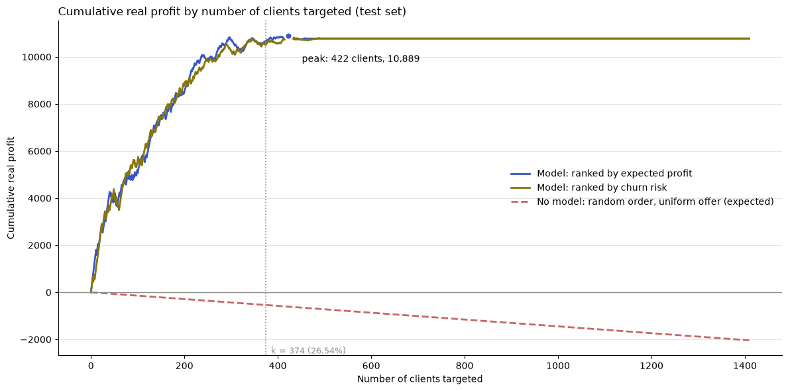
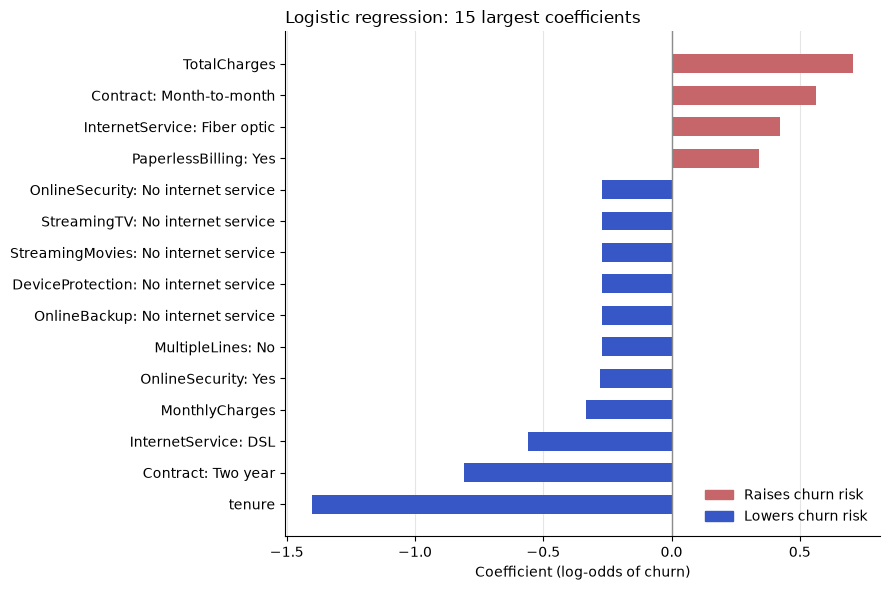
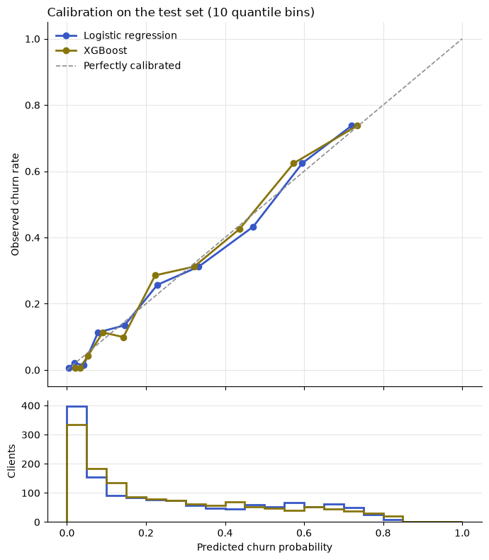

# Telco Customer Churn: Prediction and Cost-Based Retention

Which clients of a telecom company are about to leave, and which of them are worth a retention offer? This project predicts churn for 7,043 clients and turns the predictions into a retention policy: whom to offer a discount, how large and for how long, so that the expected profit is as high as possible.

The full analysis is in [`churn_prediction.ipynb`](churn_prediction.ipynb).

## Key Findings

- **A simple model is enough.** A logistic regression ranks churners about 2.5 times better than random (test average precision $0.653$ vs a churn rate of $0.265$). A tuned XGBoost model is only slightly better ($0.660$), so the simpler and more interpretable logistic regression is used for the business model.
- **The predicted probabilities can be trusted.** Both models are well calibrated (Brier score $0.134$ vs $0.195$ for a no-skill baseline), so their probabilities can be used directly in profit calculations.
- **New clients, month-to-month contracts and fiber-optic internet churn most.** 47% of clients in their first year churn, 43% of month-to-month clients and 42% of fiber-optic clients, compared with 3% of clients on two-year contracts.
- **Without a model, a retention campaign loses money.** Offering the best uniform discount to all 1,409 test clients loses 2,043 (in units of monthly charges), and only 0.2% of 1,000 random campaigns make any profit: most of the discount goes to clients who would have stayed anyway.
- **With the model, the campaign becomes profitable.** Targeting the top 26.54% of clients by expected profit earns 10,679 with 374 offers (28.6 per offer), 99% of what targeting every client with a positive expected profit earns (10,780 with 458 offers). The most profitable campaign size is about 30% of the clients (10,889).

The business results depend on assumptions about how clients respond to discounts and on benchmark costs, which should be checked with an A/B test and real cost data before the policy is used.

## Key Findings in Charts



Clients ranked by the model's expected profit (blue) or churn risk (gold) and targeted from the top: the profit rises steeply over the first 250–300 clients and peaks after 422 clients (30% of the test set) at 10,889. A campaign without a model (red, random order with a uniform offer) loses money with every additional client.



Short tenure, month-to-month contracts, fiber-optic internet and paperless billing raise the predicted churn risk; two-year contracts and DSL lower it. `tenure`, `TotalCharges` and `MonthlyCharges` are strongly correlated, so their individual coefficients should not be interpreted on their own.



Both models' calibration curves follow the diagonal: among clients with a predicted churn probability of about 0.3, about 30% actually churn. This is what allows the probabilities to be used directly in the expected-profit calculations.

## Questions

1. How well can churn be predicted, and which model is the most suitable and convenient to use?
2. Are the predicted churn probabilities reliable enough to be used directly in profit calculations?
3. Which clients should receive a retention discount, and which offer, to maximize the expected profit?
4. How much does the model add compared with a campaign run without one?

## Data

The [Telco Customer Churn](https://www.kaggle.com/datasets/blastchar/telco-customer-churn/data) dataset published on Kaggle. It is an IBM sample dataset that, according to [IBM](https://community.ibm.com/community/user/businessanalytics/blogs/steven-macko/2019/07/11/telco-customer-churn-1113), describes a fictional telecom company providing home phone and internet services to 7,043 clients in California in one quarter. Its 21 columns cover demographics, account information (tenure, contract, payment method, monthly and total charges), the subscribed services and whether the client left within the last month (`Churn`, 26.54% of the clients). The 11 blank `TotalCharges` values all belong to new clients with a tenure of 0 months and are imputed with zeros.

## Approach

- **Exploratory analysis** of churn rates by contract, tenure and internet service, and of the distributions of monthly charges and tenure.
- **One preprocessing pipeline** (`ColumnTransformer` inside each model's `Pipeline`), so that imputation, scaling and one-hot encoding are refit inside every cross-validation fold.
- **A logistic regression baseline** compared with **XGBoost**, first with default hyperparameters and then tuned with Optuna (100 trials, seeded TPE sampler), using 5-fold stratified cross-validation and average precision on the training set, and a final comparison on a held-out test set (20%).
- **A calibration check** (calibration curves, ROC-AUC and Brier score), because the business model uses the probabilities directly.
- **A business model of a discount-based retention action:** a discount of size $d$ (from a menu of 10%, 15%, ..., 50%) for $t$ months retains a share $e(d, t) = e_{max} \cdot (d/100)^a \cdot (t/24)^b$ of the clients who would otherwise churn. For every client, the offer with the highest expected profit gain is chosen:

$$P_e = \mu \cdot \big[p(R) - \big(1 - p(c)\big)\big] \cdot m \cdot H - L - c_0$$

  where $p(c)$ is the predicted churn probability, $p(R)$ the probability that the client stays after the offer, $m$ the monthly charges, $H = 24$ months the horizon, $\mu = 0.6$ the contribution margin, $L$ the expected discount given and $c_0 = 2$ the fixed cost of an offer.
- **Five targeting strategies** (random, everybody, positive expected profit, top 26.54% by risk and top 26.54% by expected profit) evaluated on the test set with the observed churn labels, plus the cumulative profit curve and 1,000 random campaigns as a reference.

## Project Structure

```
.
├── docs/
│   ├── data/
│   │   └── WA_Fn-UseC_-Telco-Customer-Churn.csv  # the dataset
│   └── index.html                                 # HTML version of the notebook (GitHub Pages)
├── images/                                        # charts used in this README
├── churn_prediction.ipynb                         # the analysis
├── requirements.txt
├── LICENSE
└── README.md
```

## How to Run

Requires Python 3.11 or newer.

```bash
git clone https://github.com/JusDice/telco-churn-cost-sensitive-xgb.git
cd telco-churn-cost-sensitive-xgb

python -m venv .venv
# Windows
.venv\Scripts\activate
# macOS / Linux
source .venv/bin/activate

pip install -r requirements.txt
```

Then open `churn_prediction.ipynb` in Jupyter or VS Code and run all cells. The Optuna search (100 trials) takes several minutes, so its cell is commented out; its best hyperparameters are hard-coded in the following cell. Uncomment the search cell to repeat it.

## Limitations

- The effect of a discount on churn ($e_{max}$, $a$, $b$), the margin and the fixed cost per offer are assumptions, not estimates: the data contain no retention campaigns and no cost data.
- A retained client is assumed to stay for the whole 24-month horizon with the same monthly charges.
- The evaluation uses the observed churn labels as a stand-in for what each client would have done without an offer.
- All results come from a single train/test split (1,409 test clients) of a fictional company in one quarter.
- Features such as fiber-optic internet are associated with churn, but the data cannot show that they cause it.

## Tools

Python, pandas, NumPy, scikit-learn, XGBoost, Optuna, matplotlib, seaborn.
